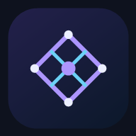
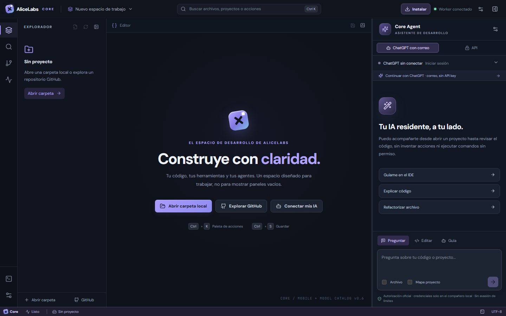
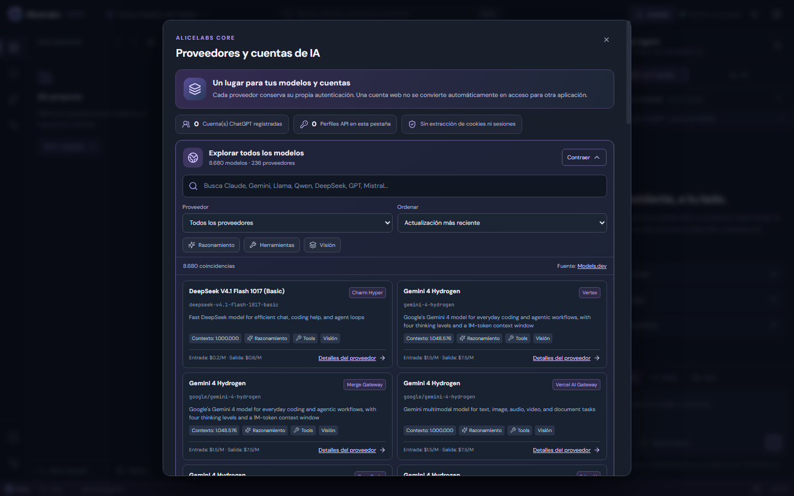
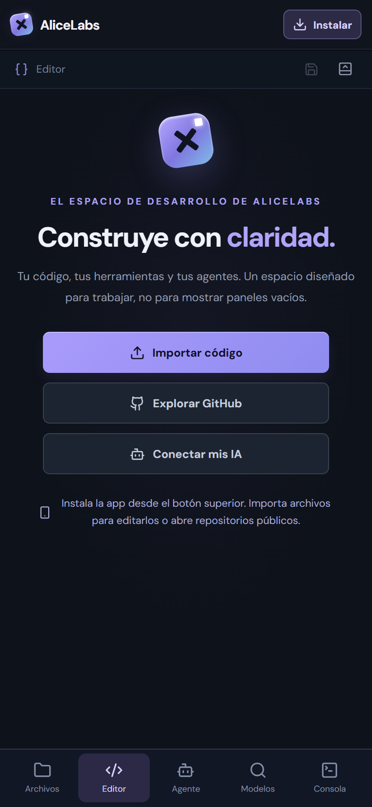
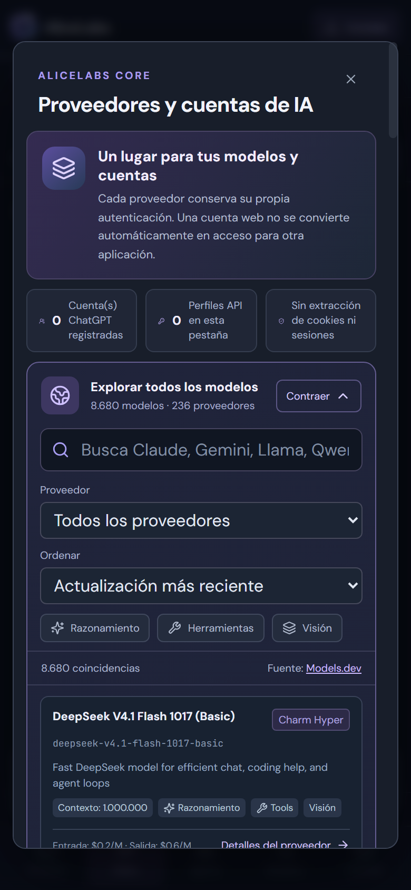

<div align="center">

<h1>AliceLabs Core</h1>
<p><strong>Un espacio de desarrollo con IA, abierto, local y centrado en tus permisos.</strong></p>
<p><a href="https://alicelabs-core.pages.dev"><strong>Abrir la IDE</strong></a> · <a href="https://github.com/eddyflores100-lang/alicelabs-core/releases/download/v0.7.0-preview/AliceLabs-Core-Android-v0.7.0-preview.apk"><strong>Descargar APK Android (prueba)</strong></a> · <a href="README.md">English</a> · <a href="docs/ARCHITECTURE.md">Arquitectura</a> · <a href="CONTRIBUTING.md">Contribuir</a></p>
</div>



## ¿Qué es?

AliceLabs Core es una IDE experimental, desarrollada con React y Monaco, publicada en Cloudflare Pages y conectada a Workers. Incluye un buscador público de miles de modelos, explorador GitHub de solo lectura, editor web, panel de asistente con propuestas revisables, perfiles API separados y un Bridge opcional para tu computadora.

**No afirmamos que sea mejor que Cursor, Cline, Aider u OpenCode.** Todavía faltan ejecución autónoma multipaso, edición Git autenticada y herramientas remotas seguras. Las funciones de la web y del cliente de escritorio Tauri no son idénticas.

## Buscar IA de muchos proveedores

En **Conectar mis IA → Explorar todos los modelos** puedes buscar en el catálogo [Models.dev](https://models.dev) con filtros de proveedor, precio (si está publicado), contexto, razonamiento, visión y herramientas. El catálogo se actualiza y contiene miles de modelos de cientos de proveedores.

**Buscar ≠ conectar:** encontrar un modelo no otorga automáticamente acceso. Core ejecuta peticiones directas a modelos desde cuentas autorizadas de OpenAI, OpenRouter, Anthropic, Gemini y DeepSeek vía sus API. Puedes agregar **varios perfiles del mismo proveedor**, cada uno con su propia clave; las claves no se guardan tras recargar.

Existe un **compañero local experimental** para iniciar sesión con ChatGPT desde la página oficial de OpenAI, sujeto a elegibilidad, consentimiento y pruebas reales pendientes. Gemini CLI y Claude Code usan sus propias sesiones en sus programas oficiales; Core no extrae esos tokens para reutilizarlos.



## Instalar en Android o iPhone

<table><tr><td width="50%"></td><td width="50%"></td></tr></table>

1. Visita **https://alicelabs-core.pages.dev** desde tu teléfono.
2. Pulsa **Instalar**. En Android Chrome usa el aviso de instalación o **⋮ → Instalar aplicación**. En iPhone Safari usa **Compartir → Añadir a pantalla de inicio**.
3. Abre la app desde su icono.

La versión PWA puede consultar modelos, leer repositorios públicos, importar archivos de texto/código, editarlos y exportar copias. Para IA necesita una conexión autorizada. **No puede usar localhost de tu computadora como si fuera el teléfono** ni ejecuta un shell remoto sin un servidor seguro que todavía no se ha implementado. El modo sin conexión es parcial.

## Estado real del proyecto

| Función | Estado |
|---|---|
| Búsqueda de miles de modelos | Disponible, metadatos públicos |
| PWA y navegación móvil | Disponible |
| Editor desktop con Monaco | Disponible en web de escritorio |
| Editor móvil e importación/exportación | Disponible |
| Cuentas API múltiples (5 proveedores directos) | Disponible durante la sesión del navegador |
| Inicio de sesión ChatGPT | Beta experimental, requiere autorización de cuenta elegible |
| Gemini/Claude con correo | Sus herramientas CLI oficiales, no sesión integrada dentro del chat Core |
| Edición mediante IA con diff y aprobación | Disponible para un archivo |
| Terminal Bridge en tu PC | Opcional, emparejamiento y aprobación por comando |
| Agente autónomo multipaso, Git write, sandbox remoto | Pendiente |
| Instalador Tauri estable | Pendiente |
| Ventanas y sesiones independientes por proyecto | Disponible en web; borradores guardados localmente |
| Dictado y avisos de tarea | Disponible donde el dispositivo conceda permisos |
| APK Android nativo (debug preview) | Compilación válida; descarga en GitHub Releases |
| Contenedores privados / avisos WhatsApp | Código y pruebas disponibles; pendientes Access, plan y credenciales Meta |

## Desarrollar en tu equipo

Requisitos: Node.js 24 y pnpm 10.

```bash
git clone https://github.com/eddyflores100-lang/alicelabs-core.git
cd alicelabs-core
pnpm install
pnpm web:dev
```

Pruebas y compilación:

```bash
pnpm web:build
pnpm test:web
pnpm test:worker
```

Con un equipo propio autorizado, puedes iniciar los componentes locales desde una terminal:

```bash
pnpm local:start
```

El programa imprime tokens temporales de emparejamiento **en tu terminal**, no en el chat. El acceso a cuentas requiere autorización real del proveedor y los comandos necesitan confirmación; no se ejecutan órdenes remotas arbitrarias desde Cloudflare.

## Arquitectura y participación

Consulta la [arquitectura](docs/ARCHITECTURE.md), el [análisis de proyectos similares](docs/COMPETITOR-REVIEW.md), las [reglas de contribución](CONTRIBUTING.md) y el [reporte de seguridad](SECURITY.md).

El proyecto es independiente, con licencia [MIT](LICENSE), y no pertenece a OpenAI, Google, Anthropic ni a los autores de las herramientas citadas.

**¿Te sirve?** [Deja una estrella en GitHub](https://github.com/eddyflores100-lang/alicelabs-core/stargazers), reporta un error reproducible o contribuye una mejora comprobable.

### Versión 0.7: varios proyectos, Android nativo y dictado

Core permite abrir **varias ventanas de proyecto** (máximo 16 en cada navegador). Cada una mantiene sus propios archivos abiertos, conversación, instrucciones y borrador, y guarda una copia local en IndexedDB. Puedes abrir la ventana activa en otra pestaña del navegador sin mezclar los proyectos. Las credenciales de los proveedores **no** se guardan en esos borradores.

Se añadió dictado en español y avisos de finalización con permisos explícitos. La versión Android hecha con Capacitor usa micrófono y avisos nativos; [consulta cómo compilarla e instalarla](apps/mobile/README.md). Los avisos requieren que la aplicación esté activa; no son notificaciones de trabajos remotos mientras esté cerrada.

El botón **Nube** permite preparar un entorno remoto por proyecto, pero el servidor no está desplegado: requiere **Cloudflare Access y Containers de pago**. También hay un adaptador de plantillas WhatsApp Business en [apps/remote](apps/remote/README.md), sin activar hasta contar con permisos, número emisor, plantilla aprobada y destinatario que acepte recibir mensajes. No se utilizan sesiones de WhatsApp Web.
