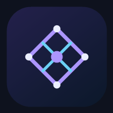
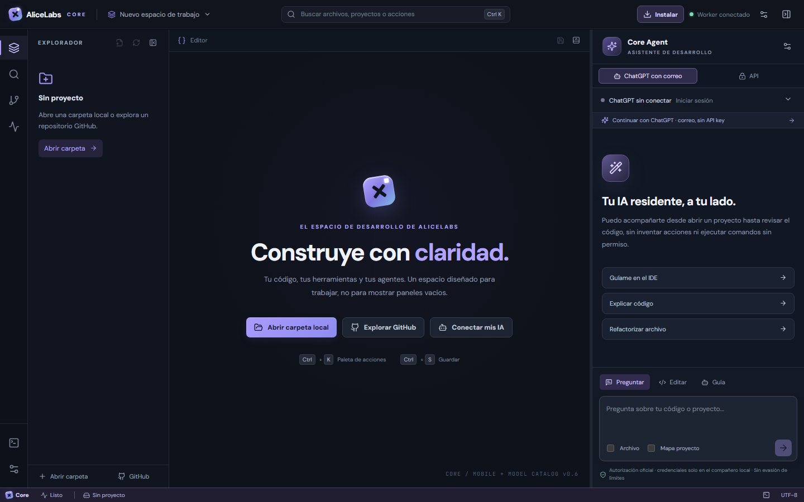
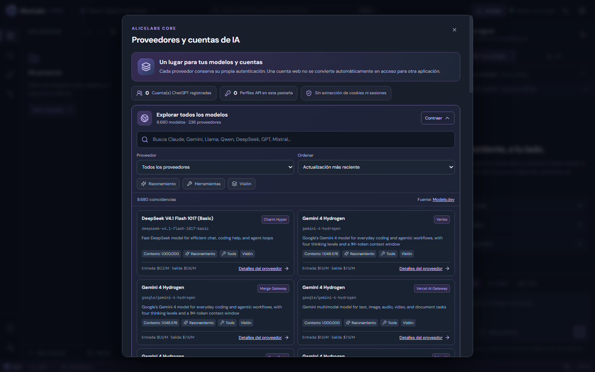
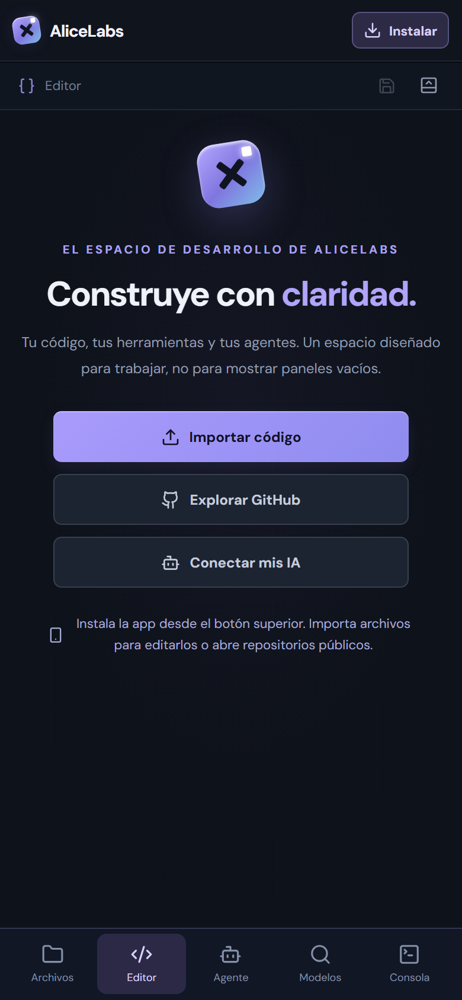
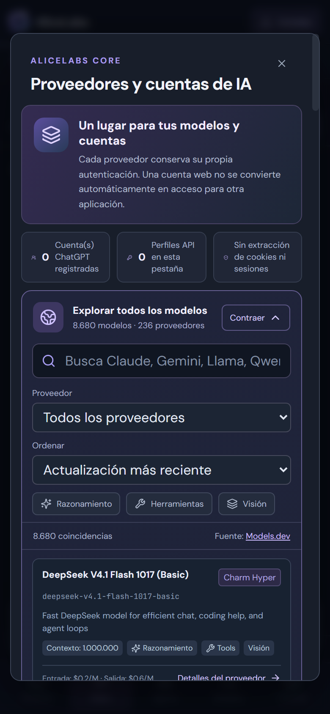

<div align="center">
  
  <h1>AliceLabs Core</h1>
  <p><strong>A local-first AI development workspace. Discover models, inspect code, and stay in control.</strong></p>
  <p>Open-source · React + Monaco · Cloudflare Pages & Workers · Experimental Tauri desktop</p>
  <p>
    <a href="https://alicelabs-core.pages.dev"><strong>Launch Web IDE</strong></a> ·
    <a href="README.es.md">Español</a> ·
    <a href="docs/ARCHITECTURE.md">Architecture</a> ·
    <a href="CONTRIBUTING.md">Contribute</a>
  </p>
  <p>
    <a href="LICENSE"></a>
    <a href="https://github.com/eddyflores100-lang/alicelabs-core/actions/workflows/core-ci.yml"></a>
    <a href="https://github.com/eddyflores100-lang/alicelabs-core/stargazers"></a>
    <a href="https://alicelabs-core.pages.dev"></a>
  </p>
</div>



## Why Core?

AI development tools tend to bundle a coding agent, a particular model provider, and a specific runtime. **AliceLabs Core is exploring a different approach:** one workspace where model discovery is separate from model access, editing is local-first, and actions requiring access to the user's computer require explicit approval.

This is an **actively developed preview**, not a finished replacement for VS Code, Cline, Aider, OpenCode, or Antigravity. The tables below distinguish shipped functionality from work still in progress.

### Explore models beyond five providers

The **universal model explorer** queries the public [Models.dev](https://models.dev) catalog through a Cloudflare Worker. It supports search, provider filtering, context size, price fields when known, and model capabilities such as reasoning, vision and tool calls.

- The public directory currently indexes **thousands of text-capable models across hundreds of providers**; counts change as Models.dev updates.
- **Discovery is not authorization.** A listing does not mean your account may invoke a model.
- Providers with direct authenticated execution in the web agent are limited to **OpenAI, OpenRouter, Anthropic, Google Gemini and DeepSeek** through their legitimate API keys, plus an **experimental** separate ChatGPT sign-in companion for eligible open-source OAuth accounts.
- Each API connection can have its own name and key, including multiple accounts with the same provider. Keys remain in the current browser tab's memory.



### Work on a phone or tablet

AliceLabs Core is a **Progressive Web App** with a touch-first mobile layout. Open the site on Android or iOS and use the **Install** button for device-specific instructions or the browser's native install prompt.

<table>
<tr><td width="50%"></td><td width="50%"></td></tr>
</table>

On mobile you can browse public GitHub repositories, search model metadata, use the assistant with an authorized connection, and import/edit/export text-based code files. **A mobile browser cannot securely reach a terminal on another computer by using localhost.** Remote terminal control is *not* a shipped feature; don't treat the installed PWA as an APK with unrestricted filesystem access.

## Features and actual status

| Capability | Web/PWA status | Notes |
|---|---|---|
| Public AI model catalog | **Available** | Models.dev metadata; search/filter/sort, thousands of models |
| Multi-provider API chat | **Available with your own API keys** | Five directly supported providers; no proxy/fingerprint bypass |
| Multi-account profiles | **In-memory** | Profiles and credentials reset on reload |
| ChatGPT account sign-in | **Experimental** | Local companion; real account eligibility and OAuth consent required |
| Gemini CLI / Claude Code | **Local native launch option** | Their own official apps, separately authenticated; not a shortcut to their subscription tokens |
| Monaco code editor | **Desktop web** | Syntax-aware local web editor |
| Mobile code editor | **Available** | Touch-friendly text editor; import and export, not a native IDE |
| Local files | **Desktop browser with permissions** | File System Access API, supported browsers only |
| Public GitHub repositories | **Read-only** | Preview files; GitHub account writing is not yet implemented in web |
| AI edit proposal | **Available** | Review a diff before applying; saving is a separate action |
| Terminal commands | **Optional on your computer** | Local Bridge, temporary pairing token, approval for each command |
| Autonomous coding agent, multi-file changes | **Not yet** | No full Plan/Act tool-execution loop or remote sandbox |
| Offline use | **Partial** | Cached application shell; model queries and online actions require connectivity |
| Tauri desktop app | **Experimental** | Separate code path in `apps/desktop`; not a production installer |

### Mobile installation

1. Open **https://alicelabs-core.pages.dev** on your phone.
2. Tap **Install**. On Android Chrome, accept the install prompt or use **⋮ → Install app**. On iPhone Safari, use **Share → Add to Home Screen**.
3. Launch AliceLabs Core from the home-screen icon.

Installing the PWA doesn't grant access to desktop files, paid AI accounts, another computer's terminal, or offline AI inference.

## Quick start (Web)

No installation is required to **browse public models** or preview public GitHub repositories.

To work with your own files on a computer, open the web IDE in a browser that supports the File System Access API, grant access to a folder, and save changes using the editor. For AI assistance, open **Connections**, connect a permitted API account, then choose the chat or reviewed-edit mode.

### Development

Prerequisites: **Node.js 24** and **pnpm 10**.

```bash
git clone https://github.com/eddyflores100-lang/alicelabs-core.git
cd alicelabs-core
pnpm install
pnpm web:dev
```

Open the URL printed by Vite. Production checks:

```bash
pnpm web:build
pnpm test:web
pnpm test:worker
```

### Optional local companions

Run this **on a computer you control**, from the cloned repository:

```bash
pnpm local:start
```

The launcher starts two localhost-only services: a terminal Bridge and a separate experimental ChatGPT OAuth companion. They print **short-lived pairing secrets in your own terminal**, which you enter in Core. **Never paste those tokens into issues, screenshots or chats.** Terminal commands require per-command approval. Login/consent is performed in the provider's official interface.

Do not forward localhost ports over the internet. The browser PWA on a different phone does **not** gain access to these processes.

For provider limitations and account rules, see [web documentation](apps/web/README.md), [API gateway](apps/api/README.md), and [ChatGPT companion](tools/chatgpt-companion/README.md).

### Experimental desktop shell

The Tauri/Rust desktop client under `apps/desktop` is a distinct work in progress. See [desktop setup](apps/desktop/GITHUB_APP_SETUP.md) and read its source before attempting to ship installers:

```bash
pnpm --filter @core/desktop dev
```

This does not imply that all features in the Cloudflare web IDE are already implemented in Tauri.

## Architecture

```text
Browser / installable PWA
  ├─ React + Monaco + mobile text editor
  ├─ File System Access (explicit permission, where supported)
  ├─ Public GitHub read-only viewer
  ├─ Cloudflare Worker (public model catalog)
  ├─ Cloudflare Worker (BYOK model requests → fixed provider endpoints)
  └─ OPTIONAL 127.0.0.1 companions on the same computer
       ├─ Terminal Bridge (approval before command execution)
       └─ ChatGPT OSS OAuth companion (experimental, tokens only in RAM)

Tauri desktop (separate, experimental)
  └─ Rust + React + local SQLite metadata, future native integrations
```

No shared keys or saved user credentials in Workers. Public model metadata is not an endorsement or a promise of access. Read [architecture and trust boundaries](docs/ARCHITECTURE.md) and [security policy](SECURITY.md).

## How we compare

We studied the public architecture and README of [Cline](https://github.com/cline/cline), [Aider](https://github.com/Aider-AI/aider), [OpenCode](https://github.com/anomalyco/opencode), [Continue](https://github.com/continuedev/continue), [Roo Code](https://github.com/RooCodeInc/Roo-Code) and [Gemini CLI](https://github.com/google-gemini/gemini-cli).

Our immediate focus is a *clearer distinction between model discovery, provider login, and execution authority*, plus a mobile-accessible coding workspace. Cline and Aider already have significantly more mature autonomous edits and Git workflows; Core must earn parity through real tests, not marketing claims. See the [competitive review and implementation priorities](docs/COMPETITOR-REVIEW.md).

## Roadmap

- [x] Public provider/model catalog with filters and paginated search
- [x] Mobile responsive workspace and installable PWA
- [x] Separate web agent BYOK profiles and reviewed single-file edits
- [x] Local terminal bridge with per-command approval
- [ ] Permissioned multi-file agent loop with plan, execution log and rollback
- [ ] GitHub authenticated editing, diffs, branches and PR creation
- [ ] Safe remote runtime for mobile users (authorization, scoped commands, audit)
- [ ] Persistent encrypted account vault with explicit consent and recovery
- [ ] End-to-end mobile, OAuth and provider integration tests
- [ ] Signed and reproducible cross-platform desktop installers
- [ ] Stable releases, changelog and usage benchmarks

Feature requests and bug reports are welcome via [GitHub Issues](https://github.com/eddyflores100-lang/alicelabs-core/issues). Please include OS, browser, steps to reproduce, and a screenshot **without tokens or keys**.

## Contributing

Core needs security reviews, provider adapter tests, browser/PWA testing, accessibility fixes, documentation, translations, and work on permissioned agent tools. Start with [CONTRIBUTING.md](CONTRIBUTING.md), check [open issues](https://github.com/eddyflores100-lang/alicelabs-core/issues), and open a small, tested pull request. Please disclose vulnerabilities privately as described in [SECURITY.md](SECURITY.md).

## License

[MIT](LICENSE). AliceLabs Core is an independent open-source project, **not affiliated with OpenAI, Google, Anthropic, DeepSeek, or the authors of the compared tools**. Provider names and logos belong to their owners.

<div align="center">
  <strong>Useful? Star the repository to follow progress — and help us improve the next release.</strong><br/>
  <a href="https://github.com/eddyflores100-lang/alicelabs-core/stargazers">★ Star AliceLabs Core</a>
</div>
